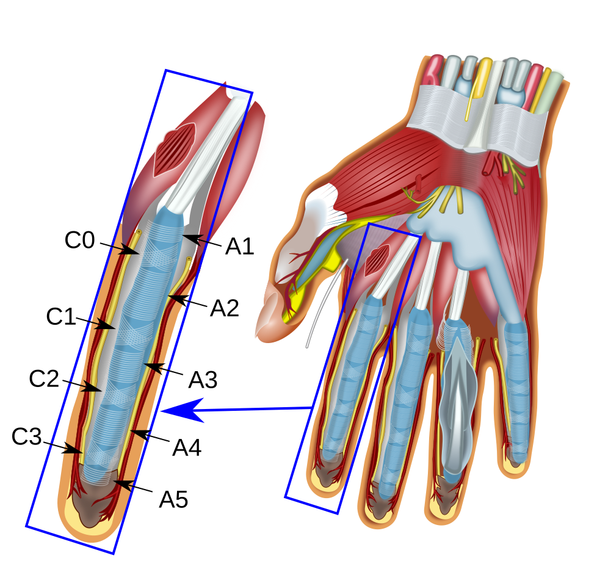
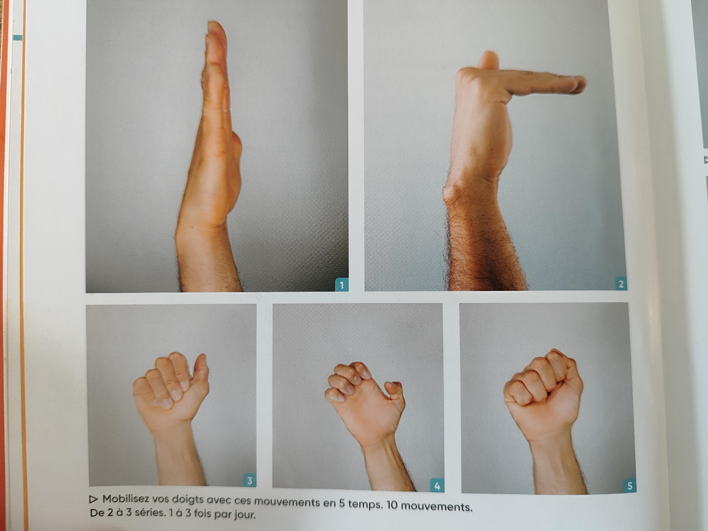

# 手指解剖结构

| 位置     | 名称  | 主要功能      | 攀岩中的作用            |
| ------ | --- | --------- | ----------------- |
| **手掌** | 屈肌腱 | 弯曲手指、完成抓握 | 主要发力结构，承担绝大部分攀抓动作 |
| **手背** | 伸肌腱 | 伸直手指、张开手掌 | 辅助作用，负责伸展手指、松开支点  |

## 指屈肌（**Flexor Digitorum**）

每根手指需要两根

| 肌肉    | 全称                                       | 来源     | 控制区域                |
| ------- | ------------------------------------------ | -------- | ----------------------- |
| **FDS** | 浅指屈肌（flexor digitorum superficialis） | 前臂     | **弯曲中节指骨（PIP）** |
| **FDP** | 深指屈肌（flexor digitorum profundus）     | 前臂深层 | **弯曲远节指骨（DIP）** |

## 滑车

| 滑车       | 位置                     | 功能                                   |
| ---------- | ------------------------ | -------------------------------------- |
| A2         | **近节指骨（靠近掌骨）** | **主要承重、固定肌腱，防止“拉弓效应”** |
| A4         | 中节指骨                 | 也用于稳定肌腱，但负荷略小             |
| A1、A3、A5 | 位于关节附近，作用较次要 |                                        |

# 常见伤病

## 手指扭伤

主要出现在手指近端指节关节（**PIP = Proximal Interphalangeal Joint **近端指间关节。）

| 症状           | 说明                                     |
| -------------- | ---------------------------------------- |
| 局部肿胀       | IPP 关节肿胀，活动受限                   |
| 按压痛         | 尤其是关节两侧（侧副韧带）或掌侧（掌板） |
| 弯曲或伸直困难 | 可能有卡顿感、疼痛限制活动               |
| 发热、淤血     | 急性期时可能伴随发红或瘀青               |
| 不稳感         | 严重拉伤后感觉关节“松”、“不稳”           |

## 滑车损伤（Pulley Injury）

D.A. Neumann, Kinesiology of the Musculoskeletal System. St. Louis: Mosby, 2002

### A2 和 A4 滑车特征

**不附着在关节上 → 缺乏周围骨性保护**

- 像 A1、A3、A5 这样的滑车，正好位于**关节囊与骨突起**附近
   → 有更多组织支撑，受力时结构更稳定
- 而 A2 和 A4 **位于指骨的中段**，没有关节的骨性突起辅助抗张力
   → 当屈肌腱被拉离指骨时，A2/A4 滑车**要独自承受所有牵拉力**

### A2 滑车最容易受伤

杠杆 = 支点 + 施力点 + 阻力点

在手指弯曲抓点时，构成如下：

- **支点**：手指各关节（尤其是指间关节）
- **施力点**：屈指肌腱（flexor tendons）连接肌肉发力处
- **阻力点**：你抓住岩点的位置（远端指节）

杠杆原理应用：

> **力矩 M = 力 F × 力臂 d**

- 在 A2 滑车处，**力臂 d 最长**（指根部距离旋转中心最远）
- 肌腱的牵引力 F 不变时，**力矩 M 最大**
- 为了抵消这个大的力矩，A2 滑车就必须施加**更大的约束力**
   → 因此它承受的“拉离骨头”的力量最大

# 预防与康复

## 理解不同的手型

- open crimp
- half crimp 
- full crimp （危险，尽量避免）

### 1️⃣ Open Crimp（开放式扣指 / Open-Hand）

- **手指形态：**
   手指相对伸展，关节弯曲幅度小。指尖、第二关节和支点接触，手指呈弧形而不是直角。
- **拇指位置：**
   拇指通常不压在食指上（不“锁”指）。
- **特点：**
  - **受力更均匀**：负荷分散到滑车、肌腱，压力相对小。
  - **对滑车更友好**：A2 滑车压力比 crimp 小得多，受伤风险低。
  - **力量消耗较大**：比 half crimp 省力性差一些，需要更强指屈肌耐力。
- **使用场景：**
   大多数圆滑、条状支点（edges），尤其是长时间挂点、保护手指时推荐使用。

------

### 2️⃣ Half Crimp（半扣指 / Half Crimp）

- **手指形态：**
   手指第一关节（指尖关节）弯曲接近 90°，第二关节略弯，整体手指呈半扣形。
- **拇指位置：**
   拇指可以不压，也可以轻压在食指上辅助发力（但不完全像 full crimp）。
- **特点：**
  - **能产生更大指力**：比 open crimp 更有力，可以挂更小的点。
  - **对滑车压力较大**：A2 滑车受力比 open crimp 大，但比 full crimp 小。
  - **受伤风险中等**：适合训练和实际攀爬，但要控制频率和强度。
- **使用场景：**
   小条点、需要更大抓力的线路。

### 3️⃣ Full Crimp（完全扣指 / 实指扣）

- **手指形态：**
   第一关节完全弯曲超过 90°，几乎折直；第二关节明显弯曲。
- **拇指位置：**
   拇指扣在食指上锁住，帮助产生更大的力。
- **特点：**
  - **指力最强**：能挂住最小的点。
  - **滑车压力最大**：A2 滑车负荷非常大，是最容易受伤的握法。
  - **风险高**：容易造成滑车断裂，尤其是未热身或疲劳时。
- **使用场景：**
   极小条点、比赛关键点、没有 open 或 half crimp 可用时的“最后手段”。

三种抓握方式对比表

| 姿势           | 手指形态                     | 拇指     | 力量 | 滑车压力 | 适用场景                     | 风险 |
| -------------- | ---------------------------- | -------- | ---- | -------- | ---------------------------- | ---- |
| **Open Crimp** | 手指呈弧形，第一关节不折直   | 不压     | ⭐⭐   | ⭐        | 大条点、耐力训练、保护手指时 | 低   |
| **Half Crimp** | 第一关节约 90°，第二关节微弯 | 可轻压   | ⭐⭐⭐  | ⭐⭐       | 小条点、需要更大指力时       | 中   |
| **Full Crimp** | 第一关节超过 90°，指尖折直   | 拇指锁指 | ⭐⭐⭐⭐ | ⭐⭐⭐      | 极小条点、比赛关键点         | 高   |

> ⭐ 越多代表程度越高

------

💡 **训练和攀爬建议：**

- 平时多用 open crimp 保养手指。
- half crimp 可以作为主要指力训练姿势，但要循序渐进。
- full crimp 只在必要时使用，训练量应少且注意充分热身，避免疲劳状态

## 手指灵活性训练

### 1️⃣ 预防伤病

- **减少关节僵硬**：让 MCP、PIP、DIP 关节保持活动度，避免长期攀爬导致手指“僵硬弯曲”。
- **降低腱鞘炎风险**：通过活动促进血液循环，让肌腱和滑车得到更好润滑，减少摩擦。
- **平衡肌群**：防止屈肌（抓握肌）过度紧张，缓解手掌长期收缩的状态，避免慢性损伤。

### 2️⃣ 提高攀岩表现

- **动作更省力**：手指能更灵活地调整角度，找到最佳接触点和支撑方式。
- **抓点效率更高**：快速切换 open crimp / half crimp / pinch，动作更流畅。
- **增加触感和控制力**：灵活的手指能更好感知点的形状，提升协调性。

### 3️⃣ 加速恢复和康复

- 在康复期做轻度的关节活动，能避免关节粘连和退化，加快回归攀爬。

Blessures et traumatismes en escalade, Aurelie Dutertre

## 滑车受伤复健

### 复健三原则

1. **低强度、高频次刺激**
   - 用温和、可控的训练激活受伤部位，促进胶原蛋白重新排列。
   - 疼痛保持在 **1-2/10 以下**，不追求疲劳感或极限强度。
2. **营养支持与恢复**
   - 胶原蛋白是肌腱、韧带的主要成分（I 型胶原），受伤后身体会合成新的胶原进行修复。
   - 多补充维生素 C
   - 适度主动活动（拉伸、轻度负荷）帮助胶原纤维排列有序，提高组织强度。
3. **重新建立强度感知**
   - 通过循序渐进的康复训练，重新认识当前手指承受能力。
   - 调整线路选择，避免盲目上高难度导致二次损伤。

### 低强度悬挂（Submaximal Hangboard Rehab）

- 选择舒适的挂点，以 **50–60% 最大指力**进行悬挂。
- 悬挂 5–7 秒，休息 2–3 倍时间，重复 4–6 组。
- 重点：**累了就休息，不要勉强**，康复是为了让组织适应，而不是追求进步。
- 每周 3–4 次即可，避免连续高负荷日。

> 💡 可用弹力带辅助、减少负重，让悬挂保持轻松可控。

ChenChen 在荒野文章：https://mp.weixin.qq.com/s/vbSOnX9rHuxm88gnQ_lsyQ

### 营养知识

滑车的主要组成成分是胶原蛋白

胶原蛋白是**肌腱和韧带的主要组成成分**（主要是I型胶原）。受伤后，身体会尝试合成新的胶原蛋白来**填补和重建受损区域**。适当进行**主动活动（如拉伸、轻度活动）**也有助于胶原蛋白排列得更有序，增强组织质量。食入的胶原蛋白会被分解成小肽和氨基酸，然后在身体中重新合成。其中维生素 C 的合成胶原蛋白的重要因子！多补充维 C

## 手指扭伤-关节囊肿

# 药品（仅供参考）

- VoltarenActigo
- 大力手酒

# Reference

Best Rehab Tool for Finger Injuries: Farmer Crimps: https://www.youtube.com/watch?v=IUOm2IHylpA

